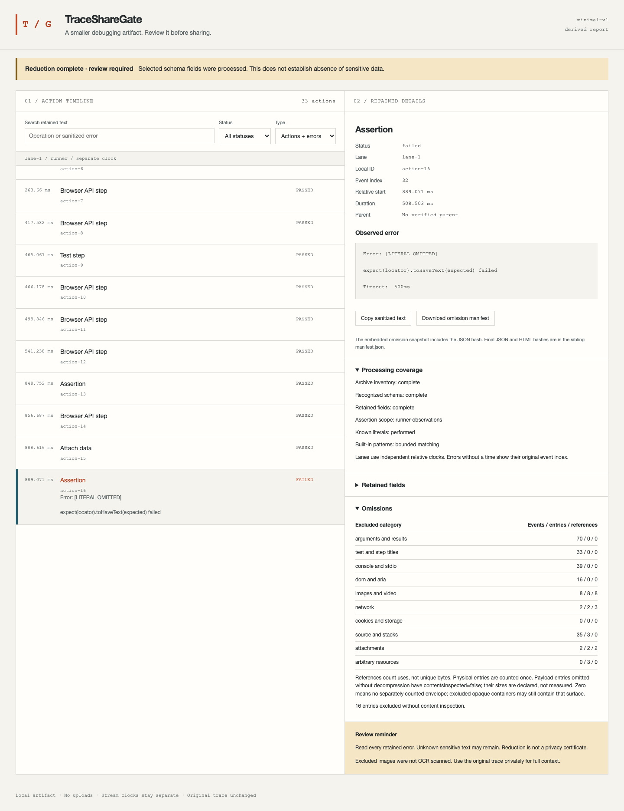

# TraceShareGate

Export minimal debugging reports from Playwright traces with an explicit omission manifest.

A local CLI for **Playwright 1.63.0 / trace schema 9**. It derives an action/error
timeline, drops high-context payloads, and shows exactly what was retained,
omitted or unknown. The original ZIP stays unchanged. Every output has
`needsReview: true`: this is a diagnostic artifact, not a replay trace or a
certificate that sensitive information is absent.

[Live synthetic report](https://mikonyaa.github.io/tracesharegate/) ·
[Release downloads](https://github.com/mikonyaa/tracesharegate/releases/tag/v0.1.0) ·
[20–30 second screenshot walkthrough](docs/demo.md)



## Why reduce a trace?

A full trace is useful for private analysis because it retains selectors,
arguments, snapshots, images, network details and source. Sharing a debugging
question often needs less: which operation failed, when, and a short explanation.
TraceShareGate deliberately loses replay context to produce that smaller artifact.

Redaction, trace sanitization and HTML reports already exist. See
[pw-sanitizer](https://github.com/4M01/pw-sanitizer),
[playwright-redactor](https://github.com/ryanrosello-og/playwright-redactor), and the
[native Trace Viewer](https://playwright.dev/docs/trace-viewer).
Our [same-sample comparison](docs/comparison.md) documents a particular
configuration, observed inventories and the context intentionally lost.

## Install the Release archive

Requires Node **22+** and npm. Runtime installation does not include Playwright or
download a browser. After dependency installation, processing uses no network,
account, cloud service or paid API. This package has not been published to npm.

```sh
mkdir tracesharegate-demo && cd tracesharegate-demo
curl -fL -o tracesharegate-0.1.0.tgz \
  https://github.com/mikonyaa/tracesharegate/releases/download/v0.1.0/tracesharegate-0.1.0.tgz
npm install --ignore-scripts --omit=dev ./tracesharegate-0.1.0.tgz
./node_modules/.bin/tracesharegate doctor
./node_modules/.bin/tracesharegate demo --out demo-output
```

Open `demo-output/report.html` locally. It works through `file://` with no network
or persistent storage. The Release also includes an example bundle and checksums.
The checksums establish byte consistency, not authenticity or privacy.

## Commands

```sh
./node_modules/.bin/tracesharegate --help
./node_modules/.bin/tracesharegate --version
./node_modules/.bin/tracesharegate inspect trace.zip --json
./node_modules/.bin/tracesharegate report trace.zip --out report --no-open
./node_modules/.bin/tracesharegate report trace.zip \
  --secrets-file local-policy/known.json --out report-with-literals
./node_modules/.bin/tracesharegate verify \
  --report report/report.json --manifest report/manifest.json --html report/report.html
./node_modules/.bin/tracesharegate verify \
  --report report-with-literals/report.json \
  --manifest report-with-literals/manifest.json \
  --html report-with-literals/report.html --secrets-file local-policy/known.json
```

All processing commands support `--json`. JSON goes to stdout; failures expose
fixed diagnostic codes, never trace lines, imported keys or filenames. `report`
and `demo` open nothing by default; `--open` explicitly asks the OS to open the
local HTML on macOS/Linux. Output directories must be new. Existing files and the
input are never overwritten.

`inspect` lists ordinal entry IDs, recognized categories and declared sizes,
without a content dump. Its exit 0 means inventory completed, not permission to share.

`report` writes **report.html**, **report.json**, and **manifest.json**. HTML embeds
only derived data and trusted renderer code. Search, status/error filters, keyboard
navigation, copy and omission download work offline. The embedded omission
snapshot includes the JSON hash; the sibling final manifest contains both JSON
and HTML hashes. This avoids a self-referential HTML hash. Use that final manifest
with `verify`, and share the three files together when retaining hash verification.

`verify` bounds and validates its inputs, checks supported policy fingerprints,
relationships, final file hashes, built-in patterns and an exact reconstruction of
the trusted renderer. It never executes imported HTML. Without a literal file it
reports `literalRecheck: "not-performed"`, even if an earlier report applied literals.
Passing the same local file reruns that check. Literal values are never cached in
an artifact. Verification is not a privacy certificate.

## Known literal file

Create an ignored `local-policy/known.json`: a JSON array of **1–128 nonempty
strings**. Put actual local values in that file, never in shell arguments/history.
A synthetic illustration is `["SYNTHETIC_EXAMPLE_ONLY"]`; it is not a credential.
The file's path and values are not copied to the report, manifest or package.

Longest overlapping literals win deterministically. Checks cover exact strings,
JSON escaping, `encodeURIComponent` variants and NFC normalization. They do not
recognize every base64 encoding, Unicode transformation or unknown secret. Whole
URLs and absolute/home paths in retained error text are replaced before literal
markers can split their spans. A retained string over 8 KiB is omitted in full.

## Retained / omitted

| Surface                                           | minimal-v1 behavior                                                        |
| ------------------------------------------------- | -------------------------------------------------------------------------- |
| Action/context IDs                                | Locally generated ordinal IDs                                              |
| Operation                                         | Tool-owned label from allowlisted class/method mapping                     |
| Timing                                            | Relative to each stream; no invented global clock mapping                  |
| Outcome                                           | passed / failed / incomplete / unknown                                     |
| Parent                                            | Only a same-lane, ordered, contained relationship                          |
| Error                                             | Bounded, redacted name/message; source/selector/value/log sections omitted |
| Titles, steps, arguments, results                 | Omitted                                                                    |
| Console, stdio, log payloads                      | Omitted                                                                    |
| DOM/ARIA snapshots, images, video                 | Omitted; images are **not OCR scanned**                                    |
| Network, cookies, storage                         | Omitted                                                                    |
| Source, stack frames, attachments, resource bytes | Omitted                                                                    |
| Unknown event/field/entry/version                 | Explicit unknown, lower coverage, exit 3                                   |

Error text is intentionally retained for diagnosis and may contain unknown sensitive
information. Read it before sharing. The HTML preview shows the final retained
text, never a hidden original, raw tooltip or before pane.

## Status and exit codes

`complete` means the selected supported scope was reduced under the policy.
`incomplete` means a partial timeline with concrete unknown/structural reasons.
`unsupported` means no supported stream was available; a diagnostic manifest is
still produced. Partial results have a prominent banner and are not promoted to
complete. An unfinished action never becomes passed. An untimed runner error shows
its original event index. Browser-only traces never establish assertion outcomes.

| Exit | report meaning                                                      |
| ---- | ------------------------------------------------------------------- |
| 0    | Supported reduction completed; human review still required          |
| 1    | Policy/literal postcondition violated; no finished artifact emitted |
| 2    | Malformed input, I/O, limits or runtime error                       |
| 3    | Unsupported or incomplete coverage                                  |
| 130  | Interrupted                                                         |

Precedence is 2 → 1 → 3 → 0. `verify` rejects unsupported policy versions; successful
consistency verification of a partial report does not upgrade its coverage.

## Format and checks

Exactly Playwright **1.63.0**, released trace family **9**, is supported in v0.1.0.
See [pinned source provenance and event kinds](docs/format-support.md). Other releases
require a separate tested adapter, even when a schema number looks familiar.
Tracing through the Test runner captures assertions; `context.tracing` alone does
not. The package includes three genuine runner failures (element timeout, navigation
error, assertion failure) and a separate browser-only ZIP.

Bounds include 100 MiB compressed input, 256 MiB processed decompressed streams,
20,000 ZIP entries, 200,000 events, 512 KiB lines, depth 32, 50,000 actions,
30 seconds and a 256 MiB worker heap budget. No entry is extracted to a filesystem
path. Traversal, collisions, encryption, unsupported compression, CRC/size mismatch
in processed streams and malformed JSON abort. See the [threat model](docs/threat-model.md).

Read [coverage definitions](docs/policy.md), [limitations](docs/limitations.md),
[maintenance](docs/maintenance.md), and [contributor checks](CONTRIBUTING.md).
Evidence in [docs/evidence](docs/evidence) records observed synthetic tests,
browser QA and clean package consumers. Public CI records the exact tested commit.
No external user feedback, universal compatibility or independent privacy audit is claimed.

MIT. Upstream format references and fixture notices: [NOTICE](NOTICE).
