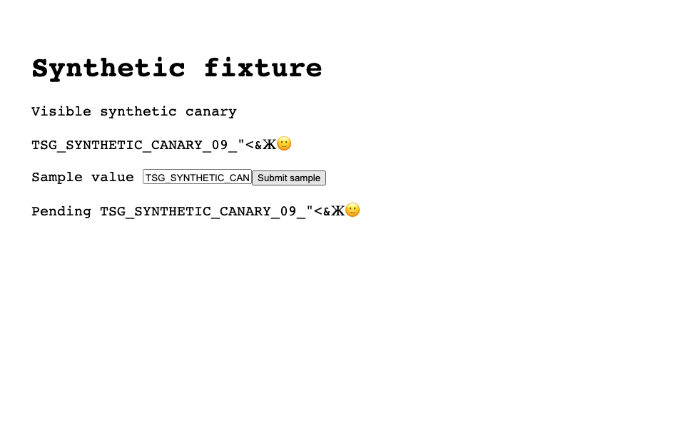
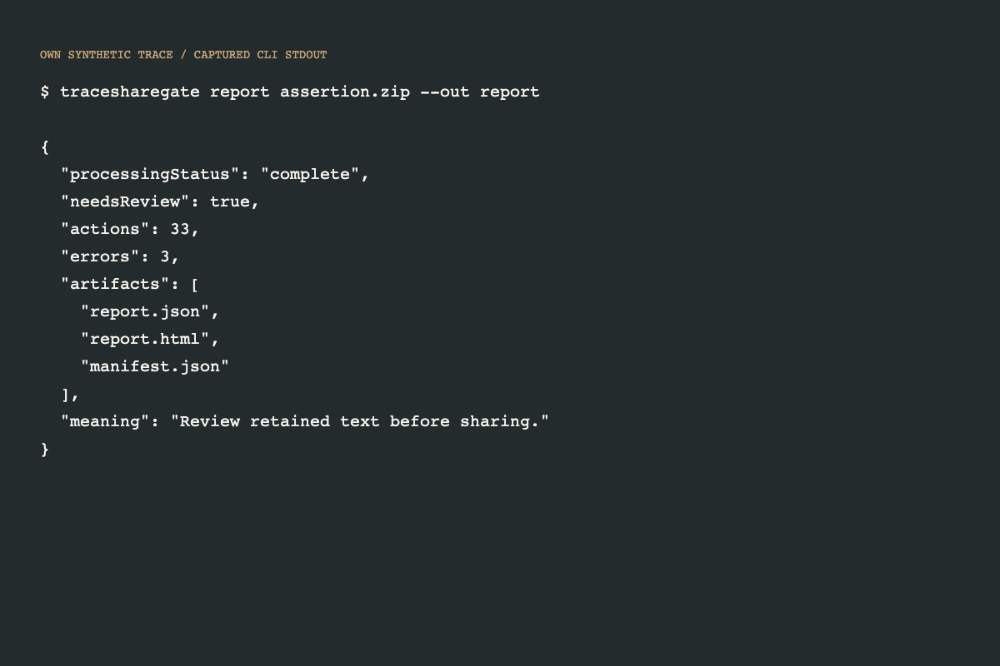
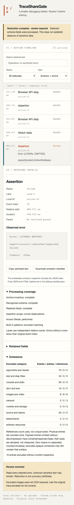

# A 20–30 second real screenshot walkthrough

All data here is synthetic, deliberately recognizable and never a credential.
The timeline screenshots come from actual reduction of a finished runner ZIP.
No prerecorded action list is supplied to the parser or viewer.

1. **0–5 seconds:** the owned fixture page visibly contains a synthetic canary.
   It also appears in action args, console/error, network, DOM and captured source.
   The screenshot's visible text was inspected; its PNG bytes are not an OCR test.

   

2. **5–10 seconds:** run `tracesharegate report assertion.zip --out report`.
   The command screenshot shows captured output from the real CLI on the packaged
   synthetic fixture; its counts are observations, not a drawn timeline.

   

3. **10–20 seconds:** open the reduced report, inspect the failed Assertion and
   retained explanation. The known selector, expected/received values and original
   user-authored title are absent. Search/filter/copy use the retained data.

   

4. **20–30 seconds:** inspect omissions and the review reminder. Download the
   omission snapshot; use the sibling final manifest to check JSON/HTML hashes.
   Unknown sensitive data may remain in retained error text. This is not a claim
   that the original or output has become universally private.

   

Reproduce with the installed Release CLI: `tracesharegate demo --out demo-output`.
The raw original stays unchanged. For deeper private debugging, open it separately
with Playwright's genuine Trace Viewer.

These screenshots are historical policy 1 evidence. Current policy 2 locator error bodies are excluded with incomplete coverage; review new local outputs for candidate behavior.
